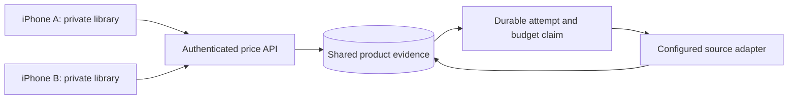

# Shared price service: local prototype

This is the first implementation step toward a public Thrifty Market app. It is
an authenticated, **localhost-only prototype**, not a public beta or deployed
service. It reuses the native Swift retailer code through a Vapor 4 server and
a separate SQLite database. The iPhone remains Swift/SwiftUI/SwiftData. Python
is not required to run either component.



The diagram describes the intended shared architecture. The current executable
binds only to `127.0.0.1`; a Mac and its iPhone simulator can exercise it locally.
Other devices cannot connect to it. Individual sessions use real, operator-issued
single-use invitations. The [native session client](NATIVE_SESSIONS.md) implements
enrollment and secure credential refresh; public networking and a hosted physical
iPhone smoke remain future work. See the [session design and contract](CLIENT_SESSIONS.md).

## Run locally

The server lockfile currently needs Swift 6.2 or newer; development and backend CI
use Xcode 26.6 / Swift 6.3.3. The iPhone app's deployment target remains iOS 17.
From the repository root:

```sh
swift test --package-path server --jobs 4 --force-resolved-versions
cd server
unset THRIFTY_ACCESS_TOKEN
swift run ThriftyMarketServer
```

The service starts with an empty cache and **live fetching disabled**. In a
second terminal, this endpoint requires no credential:

```sh
curl http://127.0.0.1:8878/health
```

`/v1/sources`, `/v1/search` and `/v1/price` require an individual session's access
token in the `Authorization: Bearer …` header. They reject browser Origin headers,
unexpected hosts, bodies, unknown query parameters and duplicate parameters.
There is no CORS allowance or request logger. The server rejects the old
`THRIFTY_ACCESS_TOKEN` environment variable instead of using it as a fallback.
Stop with Control-C.

| Environment variable | Default / allowed values |
|---|---|
| `THRIFTY_AUTH_DATABASE_PATH` | `data/client-sessions.sqlite`, separate persistent, private session database |
| `THRIFTY_SOURCE_MODE` | `disabled`; `local-research` explicitly enables existing anonymous web adapters |
| `THRIFTY_DATABASE_PATH` | `data/shared-prices.sqlite`, relative to the launch directory |
| `THRIFTY_PORT` | `8878`, range 1024–65535; hostname stays loopback |
| `THRIFTY_DAILY_LIMIT` | 50 logical upstream attempts, configurable down to 0 |
| `THRIFTY_MONTHLY_LIMIT` | 250 logical upstream attempts, configurable down to 0 |

Relative paths are resolved from the launch directory. Start the server and admin
CLI from the same directory with the same path settings. Auth and cache paths must
be different files, including symlink/hardlink aliases. Auth files must be owned
by the operator with mode `0600`; permissive or unrelated existing databases are
rejected. Do not point either path at a private app library.

### Create and enroll a local client

From another terminal, change into the same `server` directory. The local admin
executable creates a new private invitation file and never prints its credential:

```sh
umask 077
THRIFTY_OPERATOR_DIR="$(mktemp -d "${TMPDIR:-/tmp}/thrifty-session.XXXXXX")"
swift run ThriftyMarketSessionAdmin invite "$THRIFTY_OPERATOR_DIR/invitation.json"
```

The invitation expires after 24 hours and can be redeemed once. In that private
directory, create `enroll-request.json` with exactly `schemaVersion: 1` and
`invitation` copied from the invitation file. Do not send the entire invitation
file: `clientID` and `expiresAt` are not request fields. Send the request from a
local HTTP client, keeping the credential out of command arguments and URLs:

```sh
curl --silent --show-error --fail-with-body \
  --header 'Content-Type: application/json' \
  --data-binary "@$THRIFTY_OPERATOR_DIR/enroll-request.json" \
  --output "$THRIFTY_OPERATOR_DIR/session.json" \
  http://127.0.0.1:8878/v1/session/enroll
```

A successful response contains an access token valid for 15 minutes, a refresh
token valid for 30 days, the stable `clientID` and expiration times in Unix
milliseconds. Each refresh rotates both tokens. Serialize refreshes and replace
both tokens together: replaying a spent refresh token revokes the session family,
including a concurrent successful rotation. Keep credential files private and
delete them when no longer needed. Do not commit them or share them in logs/issues.

Revoke a client locally with `swift run ThriftyMarketSessionAdmin revoke CLIENT_ID`,
using its nonsecret server-issued ID. Revocation persists across server restarts.
There is no remote admin endpoint, shared fallback secret or test enrollment
bypass. [Native Keychain storage and automatic enrollment/refresh](NATIVE_SESSIONS.md)
implement the client side; these commands administer and test its server contract.

`local-research` is a personal, bounded testing option. It is **not** approval to
redistribute any retailer's prices publicly. Real fetching was not needed for
the prototype tests. No provider subscription, retailer account or bypass was added.

## Dedicated native pilot build

Select the **ThriftyMarketPilot** Xcode scheme, which uses the **Pilot** build
configuration on simulator and physical iPhone. Configure the approved HTTPS
service with the `THRIFTY_SERVICE_URL` **build setting**; it becomes the compiled
`ThriftyServiceURL` Info.plist value. No service address is committed. Xcode Run
environment variables do not configure or downgrade this build. An empty or
invalid address keeps shared fetching unavailable instead of selecting personal
retailer clients.

This installs a separate pilot bundle and keeps its local library separate from
the personal app. In **Stores**, enter the operator's single-use invitation to
connect. The credential pair stays in one device-only Keychain item, scoped to
the exact service and app. Refreshes are serialized and replace both tokens
together. An interrupted or ambiguous refresh requires a new invitation; it never
replays an unsafe saved refresh token after restart. Disconnecting clears local
credentials and preserves the pilot library; remote revocation remains an operator
action. A connected session does not prove that any price source is available.

The server documented here still binds only to localhost. A hosted HTTPS service,
signing/provisioning and a separately authorized physical-device smoke are required
before activating a beta. See [NATIVE_SESSIONS.md](NATIVE_SESSIONS.md) for build,
recovery and isolated verification instructions.

## Legacy Debug simulator opt-in

For the existing **StapleScout** Debug scheme only, duplicate it as a local,
unshared scheme in Xcode's
**Manage Schemes**. In that copy, edit **Run → Arguments → Environment Variables**:

```text
THRIFTY_SERVICE_URL = http://127.0.0.1:8878
THRIFTY_ACCESS_TOKEN = accessToken from the enrolled individual session
```

This variable is still the legacy simulator transport's input; it is no longer a server
configuration variable. Keep it only in an unshared local scheme. The current
legacy transport does not refresh sessions: after 15 minutes, obtain a rotated access
token through the documented refresh endpoint and restart the simulator app with
the new value. Do not embed access or refresh tokens in project files or a binary.

Run the simulator app. Its existing search and refresh actions now use the shared
service. A disabled source returns an explicit error; it does not fall back to
retailer requests. An incomplete configuration also fails without fallback.
With neither variable set, the simulator retains the existing personal direct-fetch
behavior. Physical-device builds ignore these environment variables and still use the
existing personal clients; this prototype does not change the shipping configuration.
Remove both variables to return the simulator to that behavior. No user library migration
or clearing of existing data is required.

HTTP is accepted only for loopback development. The transport also supports an
explicit HTTPS service URL, rejects redirects, and never sends the credential
as a query parameter. There is no committed server URL or token.

## API version 1

All successful price/search responses contain `schemaVersion: 1`, the exact
`context`, `cacheHit`, and `servedAt`. Money and package quantities are decimal
strings; dates are Unix milliseconds. `servedAt` records delivery, **not** a new
price observation. Original observation/retrieval dates, currency, package,
availability, conditions, exclusions and promotion start/end dates are retained.

| Endpoint | Request |
|---|---|
| `GET /health` | None; minimal service status, no prices or paths |
| `POST /v1/session/enroll` | Strict JSON `schemaVersion: 1` plus single-use `invitation`; no query or Authorization header |
| `POST /v1/session/refresh` | Strict JSON `schemaVersion: 1` plus `refreshToken`; no query or Authorization header |
| `GET /v1/sources` | None; fetching status and unapproved public access for all five stores |
| `GET /v1/search` | `store`, `channel`, `q`, plus `storeCode` for location-specific stores |
| `GET /v1/price` | `store`, `channel`, `productID`, plus `storeCode` for location-specific stores |

Example request path:
`/v1/price?store=wegmans&storeCode=133&channel=in_store&productID=94427`.
Wegmans/Lidl product IDs are numeric; H Mart uses `productID:skuID`.
Responses contain public product evidence only. Error bodies expose a stable
code and safe message, never upstream response text or database paths.
Session endpoints instead return private credentials with `Cache-Control: no-store`;
their bounded request/response and error contract is in [CLIENT_SESSIONS.md](CLIENT_SESSIONS.md).

Only the native clients' currently supported contexts are accepted:

| Retailer | Store code | Channel | Evidence limit |
|---|---|---|---|
| Wegmans | `133` | `in_store` | Chantilly source only |
| H Mart | Omitted | `online` | National online reference; local-price exclusion preserved |
| Lidl | `US01112` | `in_store` | Regional US1112 offer, validity dates and unknown local stock preserved |
| Walmart / Target | None enabled | None enabled | Data access unresolved; no new price adapter |

`400` means invalid context/query, `401` missing or invalid credentials, `429`
budget exhausted or already attempted without usable evidence, `502` unusable
upstream evidence, and `503` disabled source or unavailable storage. The iPhone
also rejects wrong context/source/product/schema, stale or future observations,
invalid decimals and expired offers before saving evidence. Match approval and
comparison eligibility remain independent of fetching.

## Cache and limits

Keys contain retailer, exact physical store code (or the explicit national online
context), channel, operation and product ID / normalized query. Different users'
local location UUIDs do not split the same store's cache. Search results are
bounded to five products. Product and search caches are separate; this first
version does not seed an exact-price cache from search results.

Within one server process, concurrent identical requests share one upstream
operation. Across SQLite connections/processes, transactional durable claims
prevent duplicate attempts, but another process receives `attempted_today` while
the first is working. This is not a distributed worker queue or lease system.

Successful evidence is reused only on the same UTC day while less than 48 hours
old and within its source offer window. Serving it never renews timestamps.
Expired, failed or partial responses are not silently retried on that UTC day.
Claims and budgets survive restart; failures consume a budget slot. A slow
previous-day request cannot overwrite a newer day's cache entry. Price and search
attempts share the daily/monthly budget. Cached hits do not consume another slot.
There is no scheduler: upstream work happens only on an explicit request.

Limits count **logical adapter calls**, not retailer HTTP requests, provider
credits or dollars. Search can make several network requests to validate its
candidates. The 250/month default is a conservative prototype cap, not a promise
of compatibility with a particular free provider plan. A paid provider will need
its own verified quota accounting before integration.

SQLite uses WAL, a busy timeout and transactions. Payloads are limited to 1 MB
and 5,000 cache entries. Attempts/budget history is retained; there is no retention
policy yet. The server stores no user account, staple list, match approval or
receipt. **Search terms are stored as cache keys**, so they must be included in a
future privacy/retention policy. Keep this database separate from the iPhone's
private SwiftData library. Database files and local credentials are ignored by git.

The separate auth database retains server-generated client/session IDs, credential
hashes, creation/enrollment/expiry/revocation times, refresh replay tombstones and
minimal quota counters. It does not retain the plaintext credentials, email,
device identifiers, IP address or local library UUIDs. Access requests, including
cache hits, use a persistent 1,000/day client limit; enrollment, refresh and invalid
authentication have additional bounded counters. These are pilot abuse controls;
actual provider-credit accounting remains issue #44. Full identity deletion and
retention policy remain issue #46.

## Next milestones before inviting the public

1. Obtain and verify store-specific data access and permission for public display,
   caching and retention. Walmart OPD approval is unavailable and Target's internal
   endpoint is not a public integration agreement. A working website fetch alone
   does not establish these rights for any retailer. Follow up with providers
   before picking a Walmart/Target implementation.
2. Validate exact local product identity, channel, price type, freshness, stock and
   offer conditions against a small Chantilly beta catalog. Unknown coverage must
   stay visible. Do not present national online prices as a physical store's shelf price.
3. Verify the native invitation/Keychain/serialized-refresh client against the
   separately prepared HTTPS environment on a physical iPhone. Add hosting, secrets management,
   monitoring and source failure controls. Review search-term privacy,
   retention/deletion and provider-specific credit limits. Public self-service
   enrollment needs a separate design; deployment needs separate authorization.
4. Select a shared production database and a worker/lease design if multiple
   service processes are needed. Load-test cache hit rates, source quotas,
   failure/recovery and actual operating cost before committing to a free tier.
5. Add public-build configuration and onboarding, then a deliberately limited
   TestFlight pilot (roughly 25–50 people) before expanding locations or access.

The current code proves request sharing, persistence and native transport. It does
not establish public-source agreements, public capacity, provider economics,
public self-service enrollment or App Store readiness.

## Validation

Backend tests use an in-memory/temporary SQLite database and fake upstream.
Transport tests use URLProtocol fixtures. App tests use in-memory SwiftData and
one synthetic loopback HTTP listener to exercise the simulator's real URLSession
and network policy; none call live retailers or open a user library.

```sh
swift test --package-path server --jobs 4 --force-resolved-versions
swift test --package-path iOS/Packages/StapleScoutKit
uv run pytest
```

Run the Xcode tests as described in the root README. The important integration
case searches, tracks, approves, reopens and refreshes through the shared
transport while preserving original evidence, keeping unknown stock excluded
from winners, and leaving private match decisions on device.

Implementation references: [Vapor 4](https://docs.vapor.codes/getting-started/hello-world/),
[Vapor Testing](https://docs.vapor.codes/advanced/testing/),
[Swift toolchains](https://www.swift.org/install/macos/).
