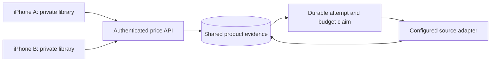

# Shared price service: local prototype

This is the first implementation step toward a public Thrifty Market app. It is
an authenticated, **localhost-only prototype**, not a public beta or deployed
service. It reuses the native Swift retailer code through a Vapor 4 server and
a separate SQLite database. The iPhone remains Swift/SwiftUI/SwiftData. Python
is not required to run either component.



The diagram describes the intended shared architecture. The current executable
binds only to `127.0.0.1`; a Mac and its iPhone simulator can exercise it locally.
Other devices cannot connect to it. Public networking and accounts are future work.

## Run locally

The server lockfile currently needs Swift 6.2 or newer; development and backend CI
use Xcode 26.6 / Swift 6.3.3. The iPhone app's deployment target remains iOS 17.
From the repository root:

```sh
swift test --package-path server --jobs 4 --force-resolved-versions
cd server
export THRIFTY_ACCESS_TOKEN="$(openssl rand -hex 32)"
swift run ThriftyMarketServer
```

Keep the token private and reuse it in the simulator's Xcode Run environment.
Do not put credentials in a scheme, project file, URL, issue or source control.
The service starts with an empty cache and **live fetching disabled**. In a
second terminal, this endpoint requires no credential:

```sh
curl http://127.0.0.1:8878/health
```

`/v1/sources`, `/v1/search` and `/v1/price` require the access token in the
`Authorization: Bearer …` header. They reject browser Origin headers, unexpected
hosts, bodies, unknown query parameters and duplicate parameters. There is no
CORS allowance or request logger. The token is a single developer credential,
not production user authentication. Stop with Control-C.

| Environment variable | Default / allowed values |
|---|---|
| `THRIFTY_ACCESS_TOKEN` | Required, 32–256 printable ASCII characters; generate randomly |
| `THRIFTY_SOURCE_MODE` | `disabled`; `local-research` explicitly enables existing anonymous web adapters |
| `THRIFTY_DATABASE_PATH` | `data/shared-prices.sqlite`, relative to the launch directory |
| `THRIFTY_PORT` | `8878`, range 1024–65535; hostname stays loopback |
| `THRIFTY_DAILY_LIMIT` | 50 logical upstream attempts, configurable down to 0 |
| `THRIFTY_MONTHLY_LIMIT` | 250 logical upstream attempts, configurable down to 0 |

`local-research` is a personal, bounded testing option. It is **not** approval to
redistribute any retailer's prices publicly. Real fetching was not needed for
the prototype tests. No provider subscription, retailer account or bypass was added.

## Use from the iPhone simulator

Duplicate the StapleScout scheme as a local, unshared scheme in Xcode's
**Manage Schemes**. In that copy, edit **Run → Arguments → Environment Variables**:

```text
THRIFTY_SERVICE_URL = http://127.0.0.1:8878
THRIFTY_ACCESS_TOKEN = the same private token used by the server
```

Run the simulator app. Its existing search and refresh actions now use the shared
service. A disabled source returns an explicit error; it does not fall back to
retailer requests. An incomplete configuration also fails without fallback.
With neither variable set, the simulator retains the existing personal direct-fetch
behavior. Physical-device builds ignore these environment variables and still use the
existing personal clients; this prototype does not change the shipping configuration.
Remove both variables to return the simulator to that behavior. No user library migration
or clearing of existing data is required.

HTTP is accepted only for loopback development. The transport also supports an
explicit HTTPS service URL, rejects redirects, and never sends the credential
as a query parameter. There is no committed server URL or token.

## API version 1

All successful price/search responses contain `schemaVersion: 1`, the exact
`context`, `cacheHit`, and `servedAt`. Money and package quantities are decimal
strings; dates are Unix milliseconds. `servedAt` records delivery, **not** a new
price observation. Original observation/retrieval dates, currency, package,
availability, conditions, exclusions and promotion start/end dates are retained.

| Endpoint | Required query parameters |
|---|---|
| `GET /health` | None; minimal service status, no prices or paths |
| `GET /v1/sources` | None; fetching status and unapproved public access for all five stores |
| `GET /v1/search` | `store`, `channel`, `q`, plus `storeCode` for location-specific stores |
| `GET /v1/price` | `store`, `channel`, `productID`, plus `storeCode` for location-specific stores |

Example request path:
`/v1/price?store=wegmans&storeCode=133&channel=in_store&productID=94427`.
Wegmans/Lidl product IDs are numeric; H Mart uses `productID:skuID`.
Responses contain public product evidence only. Error bodies expose a stable
code and safe message, never upstream response text or database paths.

Only the native clients' currently supported contexts are accepted:

| Retailer | Store code | Channel | Evidence limit |
|---|---|---|---|
| Wegmans | `133` | `in_store` | Chantilly source only |
| H Mart | Omitted | `online` | National online reference; local-price exclusion preserved |
| Lidl | `US01112` | `in_store` | Regional US1112 offer, validity dates and unknown local stock preserved |
| Walmart / Target | None enabled | None enabled | Data access unresolved; no new price adapter |

`400` means invalid context/query, `401` missing or invalid credentials, `429`
budget exhausted or already attempted without usable evidence, `502` unusable
upstream evidence, and `503` disabled source or unavailable storage. The iPhone
also rejects wrong context/source/product/schema, stale or future observations,
invalid decimals and expired offers before saving evidence. Match approval and
comparison eligibility remain independent of fetching.

## Cache and limits

Keys contain retailer, exact physical store code (or the explicit national online
context), channel, operation and product ID / normalized query. Different users'
local location UUIDs do not split the same store's cache. Search results are
bounded to five products. Product and search caches are separate; this first
version does not seed an exact-price cache from search results.

Within one server process, concurrent identical requests share one upstream
operation. Across SQLite connections/processes, transactional durable claims
prevent duplicate attempts, but another process receives `attempted_today` while
the first is working. This is not a distributed worker queue or lease system.

Successful evidence is reused only on the same UTC day while less than 48 hours
old and within its source offer window. Serving it never renews timestamps.
Expired, failed or partial responses are not silently retried on that UTC day.
Claims and budgets survive restart; failures consume a budget slot. A slow
previous-day request cannot overwrite a newer day's cache entry. Price and search
attempts share the daily/monthly budget. Cached hits do not consume another slot.
There is no scheduler: upstream work happens only on an explicit request.

Limits count **logical adapter calls**, not retailer HTTP requests, provider
credits or dollars. Search can make several network requests to validate its
candidates. The 250/month default is a conservative prototype cap, not a promise
of compatibility with a particular free provider plan. A paid provider will need
its own verified quota accounting before integration.

SQLite uses WAL, a busy timeout and transactions. Payloads are limited to 1 MB
and 5,000 cache entries. Attempts/budget history is retained; there is no retention
policy yet. The server stores no user account, staple list, match approval or
receipt. **Search terms are stored as cache keys**, so they must be included in a
future privacy/retention policy. Keep this database separate from the iPhone's
private SwiftData library. Database files and local credentials are ignored by git.

## Next milestones before inviting the public

1. Obtain and verify store-specific data access and permission for public display,
   caching and retention. Walmart OPD approval is unavailable and Target's internal
   endpoint is not a public integration agreement. A working website fetch alone
   does not establish these rights for any retailer. Follow up with providers
   before picking a Walmart/Target implementation.
2. Validate exact local product identity, channel, price type, freshness, stock and
   offer conditions against a small Chantilly beta catalog. Unknown coverage must
   stay visible. Do not present national online prices as a physical store's shelf price.
3. Replace the developer token with per-user/session authentication, rate limits
   and abuse controls; add HTTPS hosting, secrets management, monitoring and
   source failure controls. Review search-term privacy, retention/deletion and
   provider-specific credit limits. Deployment needs separate authorization.
4. Select a shared production database and a worker/lease design if multiple
   service processes are needed. Load-test cache hit rates, source quotas,
   failure/recovery and actual operating cost before committing to a free tier.
5. Add public-build configuration and onboarding, then a deliberately limited
   TestFlight pilot (roughly 25–50 people) before expanding locations or access.

The current code proves request sharing, persistence and native transport. It does
not establish public-source agreements, public capacity, provider economics,
production authentication or App Store readiness.

## Validation

Backend tests use an in-memory/temporary SQLite database and fake upstream.
Transport tests use URLProtocol fixtures. App tests use in-memory SwiftData and
one synthetic loopback HTTP listener to exercise the simulator's real URLSession
and network policy; none call live retailers or open a user library.

```sh
swift test --package-path server --jobs 4 --force-resolved-versions
swift test --package-path iOS/Packages/StapleScoutKit
uv run pytest
```

Run the Xcode tests as described in the root README. The important integration
case searches, tracks, approves, reopens and refreshes through the shared
transport while preserving original evidence, keeping unknown stock excluded
from winners, and leaving private match decisions on device.

Implementation references: [Vapor 4](https://docs.vapor.codes/getting-started/hello-world/),
[Vapor Testing](https://docs.vapor.codes/advanced/testing/),
[Swift toolchains](https://www.swift.org/install/macos/).
